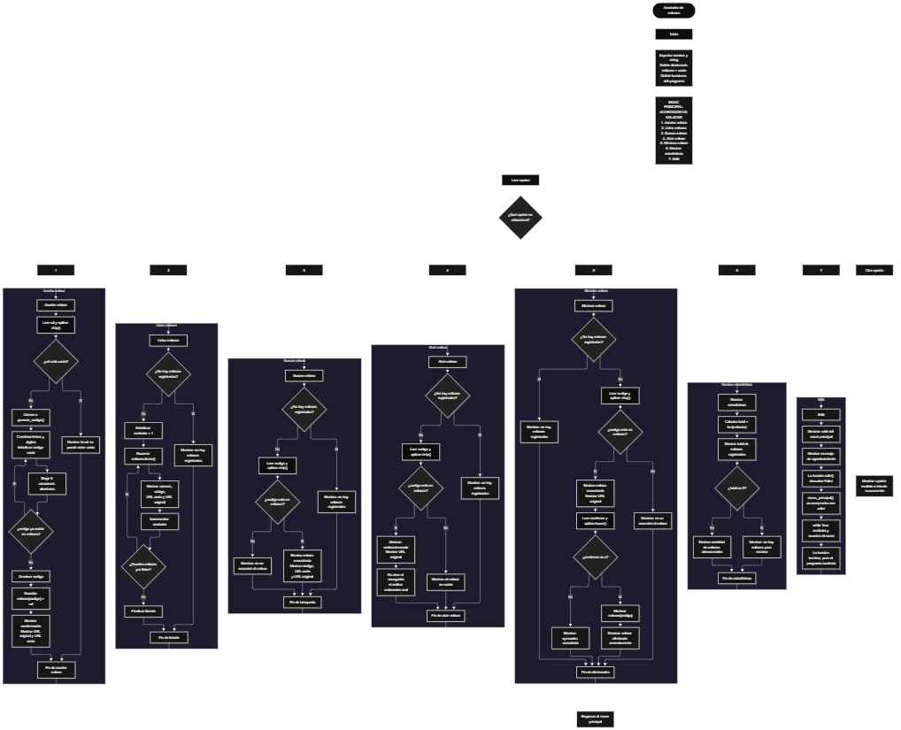

 

Este proyecto, llamado <b>acortador de enlaces</b>, fue desarrollado en <b>python</b> como un ejercicio práctico para fortalecer la lógica de programación mediante la creación de un sistema de gestión de enlaces desde la consola. El programa cuenta con un menú principal de siete opciones que permite <b>acortar, listar, buscar, abrir y eliminar enlaces, además de mostrar estadísticas</b> sobre los registros almacenados. Cada enlace se identifica mediante un código corto de seis caracteres alfanuméricos, generado aleatoriamente y asociado a su URL original mediante un diccionario. Durante su desarrollo se aplicaron conceptos fundamentales de programación, como variables, diccionarios, funciones, módulos, estructuras condicionales, ciclos repetitivos y manipulación de datos. También se incorporaron comprobaciones para evitar registrar URL vacías, reutilizar códigos existentes y realizar operaciones sobre enlaces que no están registrados. Este proyecto permite poner en práctica los conocimientos adquiridos en Python y sirve como base para desarrollar sistemas de acortamiento de enlaces más avanzados utilizando almacenamiento persistente y servicios web.

<h2 align="center">⚙️ Funcionamiento del menú principal</h2>

### 🔗 Acortar enlace

La opción <b>1) acortar enlace</b> permite registrar una URL y generar un código corto para identificarla. Primero, el programa solicita la dirección que se desea acortar mediante la función <b>input()</b> y utiliza el método <b>strip()</b> para eliminar los espacios al principio y al final de la entrada. Después, comprueba si la variable <b>url</b> está vacía mediante la condición <b>url == ""</b>. Si no se ha introducido ninguna dirección, muestra el mensaje <b>"la url no puede estar vacía."</b> y finaliza la operación. Si la entrada contiene texto, llama a la función <b>generar_codigo()</b>, que crea un código aleatorio de seis caracteres y verifica que no exista previamente en el diccionario <b>enlaces</b>. A continuación, almacena el código como clave y la URL original como valor mediante la instrucción <b>enlaces[codigo] = url</b>. Finalmente, muestra los mensajes <b>"enlace acortado correctamente."</b>, la URL original y la dirección corta formada por el prefijo <b>https://acortador.local/</b> seguido del código generado. Esta dirección se presenta como resultado en la consola; el programa todavía no implementa un servicio web que realice la redirección automáticamente.

### 📋 Listar enlaces

La opción <b>2) listar enlaces</b> permite visualizar todos los enlaces registrados durante la ejecución del programa. Primero, comprueba si el diccionario <b>enlaces</b> está vacío mediante la condición <b>len(enlaces) == 0</b>. Si no existen registros, muestra el mensaje <b>"no hay enlaces registrados."</b> y finaliza la operación. En caso contrario, inicializa la variable <b>contador</b> con el valor <b>1</b> y utiliza un ciclo <b>for</b> junto con el método <b>enlaces.items()</b> para recorrer las claves y los valores del diccionario. Durante cada repetición, muestra el número del enlace, su código, la URL corta y la URL original. Después, incrementa el contador en uno para numerar el siguiente registro. Esta función facilita consultar todos los enlaces almacenados sin necesidad de buscarlos individualmente.

### 🔎 Buscar enlace

La opción <b>3) buscar enlace</b> permite localizar un registro mediante su código corto. Antes de solicitar la búsqueda, el programa comprueba si el diccionario <b>enlaces</b> contiene registros. Si está vacío, muestra el mensaje <b>"no hay enlaces registrados."</b> y termina la operación. Si existen enlaces, solicita el código mediante <b>input()</b> y elimina los espacios externos con <b>strip()</b>. Después, comprueba si el código introducido se encuentra entre las claves del diccionario mediante la condición <b>codigo in enlaces</b>. Si el código existe, muestra el mensaje <b>"enlace encontrado."</b>, el código correspondiente, la URL corta y la URL original almacenada en <b>enlaces[codigo]</b>. Si no existe, presenta el mensaje <b>"no se encontró ningún enlace con ese código."</b>. La búsqueda se realiza utilizando el código como identificador del registro.

### 🌐 Abrir enlace

La opción <b>4) abrir enlace</b> permite consultar la dirección original asociada a un código corto. Primero, el programa comprueba si hay enlaces almacenados en el diccionario <b>enlaces</b>. Si no existen registros, muestra el mensaje <b>"no hay enlaces registrados."</b> y finaliza la operación. Si existen, solicita el código del enlace y elimina los espacios externos mediante <b>strip()</b>. A continuación, comprueba si el código se encuentra entre las claves del diccionario. Cuando existe una coincidencia, muestra los mensajes <b>"redireccionando..."</b> y <b>"url original:"</b>, seguidos de la dirección almacenada en <b>enlaces[codigo]</b>. Si el código no está registrado, muestra el mensaje <b>"el enlace no existe."</b>. En la versión actual, esta opción solamente presenta la URL original en la consola: no abre el navegador, no registra visitas y no realiza una redirección HTTP real.

### 🗑️ Eliminar enlace

La opción <b>5) eliminar enlace</b> permite eliminar un registro del diccionario después de confirmar la operación. Primero, el programa comprueba si existen enlaces almacenados. Si el diccionario está vacío, muestra el mensaje <b>"no hay enlaces registrados."</b> y termina la operación. En caso contrario, solicita el código del enlace y utiliza <b>strip()</b> para eliminar los espacios externos. Si el código existe, muestra el mensaje <b>"enlace encontrado."</b> y presenta la URL original asociada. Después, solicita confirmación mediante la pregunta <b>"¿desea eliminarlo? (s/n): "</b> y utiliza el método <b>lower()</b> para convertir la respuesta a minúsculas. Si el usuario introduce <b>"s"</b>, el programa ejecuta la instrucción <b>del enlaces[codigo]</b> para eliminar el registro y muestra el mensaje <b>"enlace eliminado correctamente."</b>. Si introduce cualquier otra respuesta, muestra <b>"operación cancelada."</b>. Cuando el código no existe, presenta el mensaje <b>"no se encontró ningún enlace con ese código."</b>. Esta operación permite administrar los registros existentes sin modificar los demás enlaces almacenados.

### 📊 Mostrar estadísticas

La opción <b>6) mostrar estadísticas</b> permite consultar la cantidad de enlaces registrados en el sistema. Al ejecutarse, muestra el título <b>"mostrar estadísticas"</b> y utiliza la instrucción <b>total = len(enlaces)</b> para obtener el número actual de elementos del diccionario. Después, presenta el resultado mediante el mensaje <b>"total de enlaces registrados:"</b>, seguido de la cantidad calculada. Si el valor de <b>total</b> es igual a cero, muestra el mensaje <b>"no hay enlaces para mostrar."</b>. Si existen registros, presenta el mensaje <b>"el acortador tiene"</b>, seguido del total y del texto <b>"enlace(s) almacenado(s)."</b>. Esta función proporciona un recuento de los enlaces que permanecen registrados en la memoria durante la ejecución, sin almacenar estadísticas históricas ni contabilizar las visitas.

### 🚪 Salir del menú principal

La opción <b>7) salir</b> está destinada a finalizar el uso del programa y muestra un mensaje de despedida mediante la función <b>salir()</b>. Al ejecutarse, presenta el texto <b>"salir del menu principal"</b> y el mensaje <b>"gracias por utilizar el acortador de Enlaces."</b>. Al final, la función devuelve el valor <b>False</b> mediante la instrucción <b>return False</b>. Sin embargo, el menú principal utiliza un ciclo <b>while True</b> y no comprueba el valor devuelto por la función <b>salir()</b>. Por este motivo, seleccionar la opción 7 muestra la despedida, pero el menú vuelve a aparecer y el programa continúa ejecutándose. Esta diferencia debe corregirse para que la opción de salida finalice el ciclo como se espera.

<h2 align="center">🧠 Temas aplicados en el proyecto</h2>

### 📦 Variables

En este proyecto se utilizan variables para almacenar las URL introducidas por el usuario, los códigos generados, las opciones del menú y los resultados de las operaciones. También se utilizan variables auxiliares para recorrer los registros y calcular el total de enlaces existentes. Cada variable cumple una función específica dentro de las operaciones de administración del acortador.

🔢 **Opcion:** Almacena la opción introducida por el usuario en el menú principal.

🔗 **Url:** Almacena temporalmente la dirección original que se desea acortar.

🔑 **Codigo:** Contiene el código corto generado o el código introducido para buscar, abrir o eliminar un enlace.

🔠 **Caracteres:** Contiene la combinación de letras mayúsculas, letras minúsculas y dígitos utilizada para generar los códigos.

🔢 **I:** Funciona como contador dentro del ciclo utilizado para construir el código de seis caracteres.

📋 **Contador:** Permite numerar los enlaces que se muestran en el listado.

📊 **Total:** Almacena la cantidad de enlaces registrados, obtenida mediante la función <b>len()</b>.

✅ **Confirmar:** Almacena la respuesta del usuario durante la confirmación de eliminación de un enlace.

### 🗃️ Diccionario

El proyecto utiliza el diccionario global <b>enlaces</b> para almacenar y administrar las direcciones registradas. Cada elemento contiene una clave correspondiente al código corto y un valor que representa la URL original. Esta estructura permite relacionar ambos datos, consultar rápidamente una dirección mediante su código, recorrer todos los registros, comprobar si existe una clave y eliminar elementos cuando el usuario lo solicita. A diferencia de los arreglos de capacidad fija, el diccionario puede aumentar o disminuir de tamaño durante la ejecución. Sin embargo, los registros se almacenan únicamente en memoria y desaparecen cuando termina el programa.

🔑 **Código corto:** Funciona como clave del diccionario y permite identificar cada enlace.

🌐 **URL original:** Funciona como valor asociado a la clave y contiene la dirección que se desea consultar.

📚 **Enlaces:** Es el diccionario que reúne todos los códigos cortos y sus respectivas URL originales.

### 🧩 Funciones

El programa está organizado mediante funciones que separan las distintas operaciones del acortador. La función <b>menu_principal()</b> administra la navegación por las opciones disponibles; <b>generar_codigo()</b> construye códigos únicos respecto a los registros actuales; y las funciones <b>acortar_enlace(), listar_enlaces(), buscar_enlace(), abrir_enlace(), eliminar_enlace()</b> y <b>mostrar_estadisticas()</b> realizan las operaciones específicas. Por último, <b>salir()</b> muestra el mensaje de despedida. Esta organización facilita la lectura del código, evita concentrar toda la lógica en un único bloque y permite identificar la responsabilidad de cada parte del programa.

### 📚 Módulos importados

El programa incorpora los módulos estándar <b>random</b> y <b>string</b> para generar los códigos cortos. El módulo <b>random</b> proporciona la función <b>random.choice()</b>, que permite seleccionar un carácter aleatorio de una secuencia. Por su parte, el módulo <b>string</b> proporciona las constantes <b>ascii_letters</b> y <b>digits</b>, que contienen las letras del alfabeto inglés en mayúsculas y minúsculas y los dígitos numéricos del cero al nueve, respectivamente. La combinación de estas constantes forma el conjunto de caracteres disponibles para crear códigos alfanuméricos.

### 🔀 Estructuras condicionales

En este proyecto se utilizan las estructuras <b>if</b>, <b>elif</b> y <b>else</b> para seleccionar las operaciones del menú y controlar el comportamiento de las funciones. Las condiciones permiten comprobar si una URL está vacía, si existen enlaces registrados, si un código pertenece al diccionario y si el usuario ha confirmado la eliminación. También se emplean para determinar si deben mostrarse los mensajes de éxito o de error. Estas estructuras permiten que el programa responda de forma diferente según los datos introducidos y el estado actual de los registros.

### 🔄 Estructuras repetitivas

El programa utiliza los ciclos <b>while</b> y <b>for</b> para controlar la ejecución y recorrer los datos. El ciclo <b>while True</b> mantiene activo el menú principal y también permite que la función <b>generar_codigo()</b> repita la generación hasta encontrar un código que no esté registrado. Dentro de esta función, un ciclo <b>for</b> construye el código seleccionando seis caracteres. Además, otro ciclo <b>for</b> recorre los elementos del diccionario durante la operación de listar enlaces. Estas estructuras permiten repetir instrucciones cuando es necesario y procesar varios registros sin escribir las mismas operaciones manualmente.

### 🔠 Generación aleatoria de códigos

La generación de códigos se realiza mediante la función <b>generar_codigo()</b>. Primero, la variable <b>caracteres</b> combina las letras y los dígitos disponibles mediante la expresión <b>string.ascii_letters + string.digits</b>. Después, el ciclo <b>while True</b> inicializa una cadena vacía en la variable <b>codigo</b> y utiliza un ciclo <b>for</b> con seis repeticiones para añadir un carácter seleccionado mediante <b>random.choice(caracteres)</b>. Una vez construido el código, el programa comprueba que no exista como clave en el diccionario <b>enlaces</b>. Si no está registrado, lo devuelve mediante <b>return codigo</b>; de lo contrario, repite el proceso. Esta lógica evita reutilizar códigos que ya estén presentes en los registros actuales.

### 🔎 Búsqueda mediante claves

El programa utiliza las claves del diccionario para identificar los enlaces. La expresión <b>codigo in enlaces</b> comprueba si el código introducido existe entre las claves almacenadas. Cuando la condición es verdadera, el programa puede recuperar la URL original mediante <b>enlaces[codigo]</b>. Esta forma de acceso se utiliza en las funciones de búsqueda, apertura y eliminación, permitiendo localizar un registro sin tener que recorrer manualmente todos los elementos del diccionario.

### 🔢 Conteo de registros

El conteo de enlaces se realiza mediante la función incorporada <b>len()</b>, que devuelve la cantidad de elementos almacenados en el diccionario. Este recurso se utiliza para comprobar si existen registros antes de realizar determinadas operaciones y para calcular el total mostrado en las estadísticas. Cuando se elimina un enlace, el número de elementos del diccionario disminuye automáticamente, por lo que las estadísticas reflejan la cantidad de registros que permanecen almacenados.

<h2 align="center">¿Cómo se implementaron las operaciones crud en el proyecto?</h2>

Las operaciones <b>crud</b> representan las acciones de crear, leer, actualizar y eliminar datos. En este proyecto, la operación <b>crear</b> corresponde a <b>acortar enlace</b>, donde se genera un código y se almacena la URL original en el diccionario <b>enlaces</b>. La operación <b>leer</b> se encuentra en las opciones <b>listar enlaces, buscar enlace y abrir enlace</b>, que permiten consultar los registros y recuperar las direcciones asociadas. La operación <b>eliminar</b> corresponde a <b>eliminar enlace</b>, donde se solicita confirmación y se borra el elemento seleccionado mediante <b>del enlaces[codigo]</b>. La operación <b>actualizar</b> no cuenta con una función independiente en la versión actual del programa, ya que el menú no ofrece una opción para modificar la URL original asociada a un código existente. La opción de estadísticas complementa estas operaciones al mostrar la cantidad actual de registros almacenados en memoria.

<h2 align="center">Diagrama de flujo del proyecto</h2>

<h2 align="center">🛡️ Validaciones del programa</h2>

### 📭 No existen enlaces registrados

Esta validación se utiliza en las opciones <b>listar enlaces, buscar enlace, abrir enlace</b> y <b>eliminar enlace</b>. El programa comprueba si la cantidad de elementos del diccionario es igual a cero mediante la condición <b>len(enlaces) == 0</b>. Si no existen registros, muestra el mensaje <b>"no hay enlaces registrados."</b> y finaliza la operación correspondiente. Esta comprobación evita solicitar códigos para realizar búsquedas o eliminaciones cuando el diccionario está vacío. En la opción de estadísticas, el programa también comprueba si el total es cero para mostrar el mensaje <b>"no hay enlaces para mostrar."</b>.

### ⚠️ URL vacía

Esta validación se utiliza durante el registro de nuevos enlaces. Después de solicitar la dirección al usuario, el programa elimina los espacios externos mediante <b>strip()</b> y comprueba si la variable <b>url</b> está vacía. Si se cumple la condición <b>url == ""</b>, muestra el mensaje <b>"la url no puede estar vacía."</b> y termina la función mediante <b>return</b>. Si la entrada no está vacía, continúa con la generación del código y el almacenamiento del registro. Esta comprobación evita registrar entradas vacías, aunque no verifica que el texto introducido tenga un formato de URL válido.

### 🔑 Código duplicado

Esta validación se encuentra en la función <b>generar_codigo()</b>. Después de construir un código de seis caracteres, el programa comprueba si ya existe como clave en el diccionario <b>enlaces</b>. Si el código ya está registrado, no lo devuelve y repite el proceso para generar otro. Si no existe, lo devuelve mediante <b>return codigo</b>. Esta comprobación evita asignar el mismo código a dos enlaces diferentes dentro de los registros actuales del programa.

### ❌ Enlace no encontrado

Esta validación se utiliza cuando el usuario introduce un código para buscar, abrir o eliminar un enlace. El programa comprueba si el código existe entre las claves del diccionario mediante la condición <b>codigo in enlaces</b>. Si existe, realiza la operación correspondiente y accede a la URL original mediante <b>enlaces[codigo]</b>. Si no existe, muestra el mensaje de error definido en cada función: <b>"no se encontró ningún enlace con ese código."</b> o <b>"el enlace no existe."</b>. De esta manera, el programa evita consultar o eliminar un registro que no se encuentra almacenado.

### 🗑️ Confirmación de eliminación

Esta validación se utiliza antes de eliminar un enlace existente. Después de mostrar la URL original, el programa solicita confirmación mediante una entrada de texto y convierte la respuesta a minúsculas utilizando <b>lower()</b>. Si la respuesta es exactamente <b>"s"</b>, ejecuta <b>del enlaces[codigo]</b> y muestra el mensaje <b>"enlace eliminado correctamente."</b>. Si la respuesta es diferente, muestra <b>"operación cancelada."</b> y conserva el registro. La comprobación permite cancelar la eliminación, aunque cualquier respuesta distinta de <b>"s"</b> se interpreta como una cancelación y no se valida específicamente que el usuario haya escrito <b>"n"</b>.

### ⚠️ Opción inválida

El menú principal utiliza una cadena de condiciones <b>if</b> y <b>elif</b> para ejecutar la función asociada a cada opción. Si el usuario introduce un valor diferente de los números comprendidos entre <b>1</b> y <b>7</b>, el programa ejecuta el bloque <b>else</b> y muestra el mensaje <b>"opción inválida, intente nuevamente."</b>. Esta validación permite informar al usuario cuando la selección no corresponde a ninguna de las operaciones disponibles, manteniendo activo el menú para que pueda intentarlo nuevamente.

### 🚪 Finalización del programa

La función <b>salir()</b> muestra un mensaje de despedida y devuelve el valor <b>False</b>. Sin embargo, el ciclo principal está definido mediante <b>while True</b> y no utiliza ese valor para detenerse. Por este motivo, seleccionar la opción <b>7</b> no finaliza la ejecución: el menú vuelve a mostrarse. Esta situación constituye una limitación de la versión actual y debe tenerse en cuenta al documentar el comportamiento del programa.

<h2 align="center">🎯 Objetivo del proyecto</h2>

El objetivo principal de este proyecto es fortalecer la <b>lógica de programación</b> mediante el desarrollo de un sistema de acortamiento y administración de enlaces en <b>python</b>. A través de su construcción se busca aplicar los conocimientos adquiridos sobre variables, diccionarios, funciones, módulos, estructuras condicionales, ciclos repetitivos y generación de datos aleatorios. Además, el proyecto permite comprender cómo relacionar identificadores con información, registrar direcciones, consultar datos, eliminar registros y calcular estadísticas en una aplicación de consola. Aunque la versión actual almacena los enlaces temporalmente y no realiza redirecciones web reales, su estructura constituye una base para futuras mejoras que incorporen almacenamiento persistente, validación de URL, apertura de enlaces y un servicio web capaz de gestionar las redirecciones.

